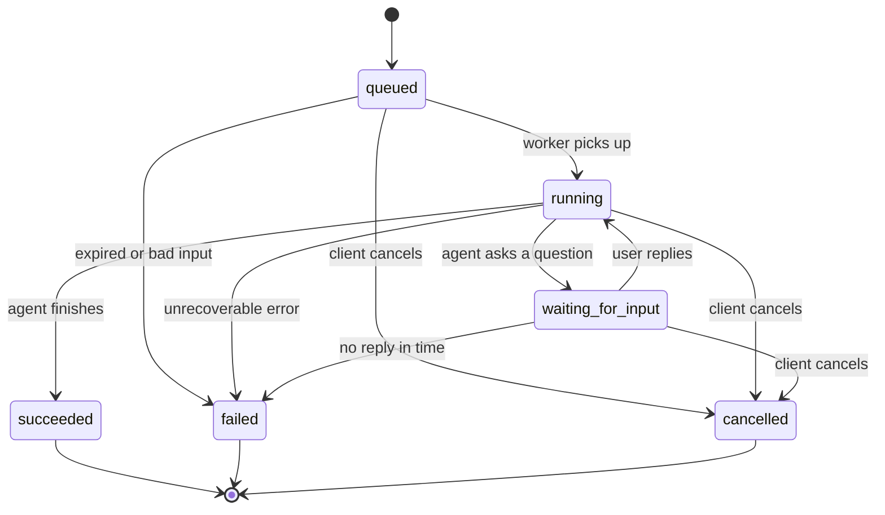

# Agent task API · design

| | |
| --- | --- |
| Author | Ajay Madhavan Ravichandran |
| Status | v1 built (in-memory storage); 122 tests passing |
| Version | v1, 28 Oct 2026; updated 30 Oct 2026 |
| Code | `labs/week04/` |

---

## 1 · Purpose and scope

**Problem:**
An agent working on a task can take minutes to finish, may stop and wait for the user's input, and may be cancelled by the user. Over that time the network can drop. This API treats each piece of agent work as a task, like a ticket: the client creates it, gets an id straight away, and checks on it later. The work carries on, and isn't lost, even if the client disconnects.

**Why not one request:**
Agent work takes minutes, not seconds: it calls tools, waits for them and reasons in a loop. It can also pause for the user's reply. Holding one HTTP request open that long is fragile: proxies cut long connections, clients disconnect, and if the connection drops the work and the answer are lost. A request also can't sit waiting for a user who might reply ten minutes later.

**How a client uses it, in one sentence:**
The client sends the work with `POST /v1/tasks` and gets back a task id straight away (202 Accepted). The agent then runs in the background on the server, while the client checks on it, by polling `GET /v1/tasks/{id}` or streaming `/events`, until the task reaches a final state.

### In scope (v1)

- The five routes: create, get, list, events and cancel.
- The task resource: its fields, and its six states with the rules for moving between them.
- The event stream format: `state_changed`, `log` and `output` events, a heartbeat, and how the stream ends.
- One error shape for every route.
- Page-token pagination, API-key authentication and idempotent create (Thursday).
- Limits on input size and page size, and versioning in the path (`/v1/`).
- In-memory storage behind a repository interface (Saturday).

### Out of scope, and why

- **The agent itself.** This week is about the contract. It can be designed and tested before anything runs behind it. Comes back in weeks 9 to 18 (capstone 1).
- **Replying to a task that is `waiting_for_input`.** It needs its own design: what a reply looks like and who may send one. The state exists now, so adding the route later isn't a breaking change.
- **A real database.** Storage goes behind a repository interface on Saturday, so swapping in Postgres later changes one file, not the API.
- **Updating or deleting tasks.** A task is a record of work that happened. Cancel covers the real need, which is "stop this".
- **Webhooks.** Polling and the event stream cover v1. Webhooks bring retries, signing and failed deliveries, which is a design of its own.
- **Reconnecting a dropped stream with `Last-Event-ID`.** A client that drops calls `GET /v1/tasks/{id}` to catch up (section 14).
- **Multi-tenancy, rate limits, scaling and billing.** These belong with the load, scale and cost work in Phases 3 and 4.
- **Automatically retrying failed tasks.** The agent may already have acted in the world (restarted a pod), so repeating it may be unsafe. The client decides, by creating a new task.

---

## 2 · Who calls it, and a walkthrough

**Callers:**
Any program that can make an HTTP call can hand the agent some work and follow its progress: a web app, a VS Code extension, a Slack bot, a CI pipeline, an alert webhook, another backend service, or a cron job.

**Walkthrough** (an alert webhook asks the operations agent to diagnose a fault):

1. **Create.** `POST /v1/tasks` with `{"input": "Diagnose: payments pods crash-looping in namespace payments"}`. The server answers **202** with the task in `queued` state and its id, `t_Qx3vL9pT2mKa8YdN1rB7cw`.
2. **Watch.** The on-call engineer's Slack bot opens `GET /v1/tasks/t_Qx3vL9pT2mKa8YdN1rB7cw/events` and receives:
   ```text
   event: state_changed   data: {"from": "queued", "to": "running"}
   event: log             data: {"message": "Listing pods in namespace payments"}
   event: state_changed   data: {"from": "running", "to": "waiting_for_input"}
   event: output          data: {"text": "Deploy 4521 went out 6 minutes before the crashes. Roll it back?"}
   ```
3. **Check.** The engineer's laptop drops the stream. Later, from another device, `GET /v1/tasks/t_Qx3vL9pT2mKa8YdN1rB7cw` returns **200** with `"state": "waiting_for_input"`, so nothing was lost.
4. **Cancel.** The engineer decides to handle it by hand: `POST /v1/tasks/t_Qx3vL9pT2mKa8YdN1rB7cw:cancel` returns **200** with `"state": "cancelled"`. The stream sends a final `state_changed` to `cancelled` and closes.
5. **Something goes wrong.** A second, retried cancel returns **200** with the task unchanged. Cancelling a different task that had already succeeded returns **409** with reason `TASK_ALREADY_FINISHED`. A typo in an id returns **404** with reason `TASK_NOT_FOUND`.
6. **List.** The bot's daily summary calls `GET /v1/tasks?page_size=20` and gets the 20 newest tasks plus a `next_page_token` for the next 20.

---

## 3 · Resources and names

| Resource | What it represents | Name pattern | Parent |
| --- | --- | --- | --- |
| Task | One piece of work given to the agent, and everything known about it | `tasks/{task_id}` | none |
| Event | One thing that happened during a task: a state change, a log line, or some output | `tasks/{task_id}/events/{event_id}` | Task |

**Id format and who creates it:**
The server creates the id, because it alone owns the task's lifecycle, and two clients can then never pick the same id (AIP-122). The format is the prefix `t_` plus 16 random bytes in URL-safe base64 (`secrets.token_urlsafe(16)`), for example `t_Qx3vL9pT2mKa8YdN1rB7cw`.
- **The prefix** makes an id's type obvious in logs and support tickets (`t_` is a task, `ev_` an event).
- **It's random rather than a hash of the creation time and input,** because a hash of known values can be recomputed by anyone who knows them, and two identical requests at the same moment would collide.
- **It's not a database counter (1, 2, 3…),** because those are easy to guess and reveal how many tasks exist.

**Cancel is not a resource, because:**
It doesn't represent a thing that exists. It's an action that changes the state of a task. Actions that don't fit the standard methods are custom methods: `POST` with a colon before the verb, `POST /v1/tasks/{task_id}:cancel` (AIP-136).

---

## 4 · Routes

"Safe" means the call changes nothing. "Idempotent" means calling it twice has the same effect as calling it once. Together they decide which calls a client may retry automatically (the week 3 lesson).

| Method and path | Purpose | AIP | Success code | Safe? | Idempotent? |
| --- | --- | --- | --- | --- | --- |
| `POST /v1/tasks` | Create a task | 133, 151 | **202** | No | No, until Thursday's `Idempotency-Key` |
| `GET /v1/tasks/{task_id}` | Get one task | 131 | 200 | Yes | Yes |
| `GET /v1/tasks` | List my tasks, page by page | 132, 158 | 200 | Yes | Yes |
| `GET /v1/tasks/{task_id}/events` | Stream a task's events | 122 | 200 | Yes | Yes |
| `POST /v1/tasks/{task_id}:cancel` | Stop a task | 136 | 200 | No | Yes |

### `POST /v1/tasks`

- **Request body:** `CreateTaskRequest`, which is `{"input": "<what the agent should do>"}`. Nothing else is accepted.
- **Response:** the new `Task`, in state `queued`.
- **Why 202, not 200 or 201:** the work has been accepted, not done (AIP-151). 200 would suggest the result is ready. 201 says "created", which is true of the ticket, but 202 tells the client the important part: come back later.
- **Errors:** 401 `API_KEY_INVALID`, 403 `INSUFFICIENT_PERMISSION`, 422 `INVALID_REQUEST_BODY`, 422 `IDEMPOTENCY_KEY_REUSED`, 422 `INVALID_HEADER`.

### `GET /v1/tasks/{task_id}`

- **Response:** the `Task`.
- **Errors:** 404 `TASK_NOT_FOUND`. Also 404 if the task belongs to another API key, so the API never reveals that someone else's task exists (Thursday).

### `GET /v1/tasks`

- **Query parameters:** `page_size` (default 20, min 1, max 100), `page_token` (default `""`).
- **Response:** `ListTasksResponse`: `{"tasks": [...], "next_page_token": "..."}`. An empty `next_page_token` means the last page; a short page does not.
- **Order of results:** newest first, by `created_at` then `id`, both descending. People usually want their recent tasks, and a fixed order with `id` as the tie-breaker is what makes Thursday's cursor work.
- **Errors:** 422 `INVALID_QUERY_PARAMETER`, 400 `INVALID_PAGE_TOKEN`.

### `GET /v1/tasks/{task_id}/events`

- **Response:** a server-sent event stream (section 7).
- **Errors:** 404 `TASK_NOT_FOUND`, returned as a normal JSON error before the stream starts.

### `POST /v1/tasks/{task_id}:cancel`

- **Request body:** none.
- **Response:** the `Task`, now in state `cancelled`.
- **Cancelling a task that is already cancelled:** 200, with the task returned unchanged. A client that retries a cancel after a network blip gets the same answer, which is what makes cancel idempotent. It's a no-op, not a `cancelled` to `cancelled` transition.
- **Cancelling a task that already succeeded or failed:** 409 `TASK_ALREADY_FINISHED`. The result can't be undone, and the client needs to know cancel didn't happen.
- **Errors:** 404 `TASK_NOT_FOUND`, 409 `TASK_ALREADY_FINISHED`.

---

## 5 · The task resource

| Field | Type | Set by | Present when | Example |
| --- | --- | --- | --- | --- |
| `id` | `str` | server | always | `"t_Qx3vL9pT2mKa8YdN1rB7cw"` |
| `state` | `TaskState` | server | always | `"running"` |
| `input` | `str`, 1 to 10,000 characters | client | always | `"Diagnose: payments pods crash-looping"` |
| `result` | `str \| None` | server | only when `state` is `succeeded` | `"Deploy 4521 set the wrong DB_HOST; rolled back."` |
| `error` | `TaskError \| None` | server | only when `state` is `failed` | `{"code": "TOOL_UNAVAILABLE", "message": "kubectl timed out 3 times"}` |
| `created_at` | `datetime` (UTC) | server | always | `"2026-10-28T14:05:11Z"` |
| `updated_at` | `datetime` (UTC) | server | always; changes on every state change | `"2026-10-28T14:07:42Z"` |

`result` and `error` are never both set. In every other state, both are `null`.

**Example task, as JSON:**

```json
{
  "id": "t_Qx3vL9pT2mKa8YdN1rB7cw",
  "state": "succeeded",
  "input": "Diagnose: payments pods crash-looping in namespace payments",
  "result": "Deploy 4521 set the wrong DB_HOST. Rolled back; pods healthy.",
  "error": null,
  "created_at": "2026-10-28T14:05:11Z",
  "updated_at": "2026-10-28T14:09:03Z"
}
```

**The client can only set `input`, enforced by:** `CreateTaskRequest` has only that one field and uses `ConfigDict(strict=True, extra="forbid")`. A request that sends `state` or `id` is rejected with a 422 rather than silently ignored, so a client can't think it set something it didn't.

**`task.error` versus an API error response:**
They answer different questions. `task.error` means **the task ran and failed**: the request to read it worked, so `GET /v1/tasks/{id}` returns **200**, and the failure is data inside the task (for example `TOOL_UNAVAILABLE`). An API error response means **your request failed**: it comes back as an HTTP error in the section 8 shape, for example **404** `TASK_NOT_FOUND` for an id that doesn't exist.

**Times are UTC,** because UTC has no daylight-saving jumps and no ambiguity between servers in different regions. Clients convert to local time for display.

---

## 6 · Task state machine ★

### 6a · States

| State | Meaning | Terminal? |
| --- | --- | --- |
| `queued` | Accepted and stored; waiting for a worker to pick it up | No |
| `running` | A worker is running the agent loop: thinking and calling tools | No |
| `waiting_for_input` | The agent has asked the user a question and is paused until they answer | No |
| `succeeded` | Finished with a result | Yes |
| `failed` | Stopped with an error and won't continue | Yes |
| `cancelled` | Stopped because the client asked | Yes |

### 6b · Questions answered first

1. **Terminal states:** `succeeded`, `failed` and `cancelled`. Nothing leaves them, because a client that has seen a final answer must be able to rely on it, and the work behind it has really stopped.
2. **Happy path:** `queued` → `running` → `succeeded`. With a question: `queued` → `running` → `waiting_for_input` → `running` → `succeeded`.
3. **`waiting_for_input`** is entered only from `running`, because only a running agent can ask something. It goes back to `running` when the user replies, to `failed` if the wait times out, or to `cancelled`.
4. **Failing before running:** yes, `queued` → `failed`, for example if no worker can take it before it expires, or the input is found to be unusable when the worker loads it.
5. **Cancel** is allowed from every non-terminal state: `queued`, `running` and `waiting_for_input`.
6. **`queued` straight to `succeeded`:** no. Only running work can produce a result, so every success passes through `running`, and the event stream always shows the task starting.
7. **A state to itself:** no. A `state_changed` event must mean something really changed. Repeating a cancel is handled by the route as a no-op (section 4), not as a transition.

### 6c · Transition table

| From ↓ / To → | queued | running | waiting_for_input | succeeded | failed | cancelled |
| --- | --- | --- | --- | --- | --- | --- |
| queued | no | **yes** | no | no | **yes** | **yes** |
| running | no | no | **yes** | **yes** | **yes** | **yes** |
| waiting_for_input | no | **yes** | no | no | **yes** | **yes** |
| succeeded | no | no | no | no | no | no |
| failed | no | no | no | no | no | no |
| cancelled | no | no | no | no | no | no |

That's 10 legal moves. Nothing moves back to `queued`, and `waiting_for_input` can't finish without running again.

### 6d · Who causes each legal move

| Move | Triggered by |
| --- | --- |
| `queued` → `running` | The worker picks the task up |
| `queued` → `failed` | The worker or the system: no worker before the task expires, or unusable input |
| `queued` → `cancelled` | The client calls `:cancel` |
| `running` → `waiting_for_input` | The agent asks the user a question |
| `running` → `succeeded` | The agent finishes with a result |
| `running` → `failed` | The agent hits an error it can't recover from (a tool keeps failing, a step limit is reached) |
| `running` → `cancelled` | The client calls `:cancel` |
| `waiting_for_input` → `running` | The user replies (the reply route comes in a later week) |
| `waiting_for_input` → `failed` | A timeout: no reply in time (not in v1, see section 14) |
| `waiting_for_input` → `cancelled` | The client calls `:cancel` |

### 6e · Diagram



### 6f · Edge cases

- **Cancel arrives at the same moment the task succeeds. Which wins?** Whichever is written first, because every state change is a check-and-set. It reads the current state, checks `can_transition`, and writes, as one step under a lock (or one conditional database update later). If success is written first, the cancel finds a terminal state and gets 409 `TASK_ALREADY_FINISHED`. If the cancel is first, the worker's success is refused, and the worker must stop. Either way the task ends in exactly one terminal state, and the client is told the truth.
- **The worker crashes while running. What state does the task end in, and who notices?** In v1, nothing notices: the task stays `running` forever. The fix is a lease. The worker must keep renewing a short lease on the task, and if the lease expires, the system moves the task to `failed` with code `WORKER_LOST`. Not in v1 (section 14).
- **A task waits for input forever. Does anything time it out?** Not in v1. The design allows `waiting_for_input` → `failed` with code `INPUT_TIMEOUT` for when a timeout is added (section 14).

---

## 7 · Event stream

> **Status:** designed, not built. The route checks auth and ownership, then returns 501, because nothing produces events until there is a worker (section 14, row 9).

**Format:** each event is sent as `event: <type>`, then `data: <TaskEvent as JSON>`, then a blank line. This is the same SSE format as week 3's `/ask`.

| Event type | When it's sent | `data` contains | Example |
| --- | --- | --- | --- |
| `state_changed` | Every time the task's state changes | `from`, `to` | `{"from": "queued", "to": "running"}` |
| `log` | The agent does a step: a tool call, a tool result, a decision | `message` | `{"message": "Listing pods in namespace payments"}` |
| `output` | The agent produces text for the user: part of the answer, or a question | `text` | `{"text": "Roll back deploy 4521?"}` |

Each `TaskEvent` also carries an `id` (for example `ev_000012`, increasing within a task) and a `created_at`.

- **Heartbeat:** a `: ping` comment every 15 seconds when there's nothing else to send, because proxies and load balancers cut connections that stay silent (week 3).
- **When the stream ends:** straight after the `state_changed` event into a terminal state. That event is always the last one, and then the server closes the stream. A client knows it's finished when it sees `to` equal to `succeeded`, `failed` or `cancelled`.
- **Opening the stream for a task that already finished:** the server replays all of the task's stored events in order, ending with the terminal `state_changed`, then closes. Every client sees the same complete story, however late it connects.
- **Reconnecting after a dropped connection:** not in v1. A client that drops calls `GET /v1/tasks/{id}` for the current state, or reopens the stream to get the full replay. Because event ids already increase, `Last-Event-ID` support can be added later without breaking anyone (section 14).
- **Event order:** guaranteed in creation order within one task. There's no ordering between different tasks.

---

## 8 · Errors

### 8a · Shape (AIP-193)

```json
{
  "error": {
    "code": 404,
    "status": "NOT_FOUND",
    "message": "Task t_9999 does not exist.",
    "details": [{ "reason": "TASK_NOT_FOUND" }]
  }
}
```

**`message` is for** the developer reading logs or a response. It's human-readable, and the wording may change. **`reason` is for** code: clients branch on it, so it's specific and never changes once released.

### 8b · Every error case

| Case | Route(s) | HTTP | `status` | `reason` |
| --- | --- | --- | --- | --- |
| Route not built yet | events, until there is a worker | 501 | `UNIMPLEMENTED` | `NOT_IMPLEMENTED` |
| Task id doesn't exist, or belongs to another key | get, events, cancel | 404 | `NOT_FOUND` | `TASK_NOT_FOUND` |
| Body fails validation (missing `input`, extra field, too long) | create | 422 | `INVALID_ARGUMENT` | `INVALID_REQUEST_BODY` |
| `page_size` out of range | list | 422 | `INVALID_ARGUMENT` | `INVALID_QUERY_PARAMETER` |
| `page_token` invalid or tampered with | list | 400 | `INVALID_ARGUMENT` | `INVALID_PAGE_TOKEN` |
| Cancel a task that has already succeeded or failed | cancel | 409 | `FAILED_PRECONDITION` | `TASK_ALREADY_FINISHED` |
| Missing or bad API key | all | 401 | `UNAUTHENTICATED` | `API_KEY_INVALID` |
| Valid key without permission for this action | create, cancel | 403 | `PERMISSION_DENIED` | `INSUFFICIENT_PERMISSION` |
| Same idempotency key, different body | create | 422 | `INVALID_ARGUMENT` | `IDEMPOTENCY_KEY_REUSED` |
| `Idempotency-Key` header empty or longer than 255 characters | create | 422 | `INVALID_ARGUMENT` | `INVALID_HEADER` |
| Unexpected server bug (caught by the catch-all `Exception` handler) | all | 500 | `INTERNAL` | `INTERNAL_ERROR` |

Notes on the codes:
- **422 versus 400.** 422 is for a request the schema rejects (FastAPI's validation). 400 is for a request that's well-formed but makes no sense, such as a page token we didn't issue.
- **401 versus 403.** 401 means "I don't know who you are". 403 means "I know who you are, and you can't do this".
- **409 for a cancel that's too late.** Google maps `FAILED_PRECONDITION` to HTTP 400. We use 409 Conflict, the usual REST code for "the resource's current state doesn't allow this", and keep Google's `status` name.
- **Someone else's task gives 404, not 403,** so the API never confirms that a task id exists for another key.

**Never in an error message:** stack traces, internal hostnames or URLs, SQL, other users' task ids or inputs, or API keys (week 3's rule).

**How every error reaches this shape** (all in `errors.py`):

| Where the error starts | Handler | Result |
| --- | --- | --- |
| Our own code raises an `ApiError` helper | `api_error_handler` | the helper's code, status and reason |
| FastAPI rejects the request before the route runs | `validation_error_handler` | 422, with the reason picked from the first error's location: `body` gives `INVALID_REQUEST_BODY`, `query` gives `INVALID_QUERY_PARAMETER`, `header` gives `INVALID_HEADER`. The message names the field, never the submitted value |
| Anything else (a bug) | `unhandled_error_handler` | 500 `INTERNAL_ERROR` with a fixed message. The traceback goes to the server log only |

**Self-check**
- [x] Every row has all five columns.
- [x] No two rows share a `reason`.
- [x] I could explain 400 versus 422 and 401 versus 403.

---

## 9 · Pagination

`GET /v1/tasks` returns the caller's tasks one page at a time (AIP-158).

- **Order:** newest first, sorted by `(created_at, id)`, descending. `id` breaks ties between tasks created at the same moment, so the order is total: every task has exactly one position.
- **Parameters:** `page_size` (default 20, between 1 and 100) and `page_token` (default `""`, meaning the first page).
- **The token:** URL-safe base64 of `{"t": <created_at ISO>, "id": <task id>}`, pointing at the last task on the previous page. Clients must treat it as opaque, so its contents can change later.
- **The next page:** tasks where `(created_at, id)` is less than the cursor. Python compares the tuples position by position, which is exactly the rule.
- **Knowing whether there is another page:** fetch `page_size + 1` tasks. If the extra one arrives, there is a next page: drop it, and build `next_page_token` from the last task returned. Otherwise `next_page_token` is `""`. With a database this is `LIMIT page_size + 1`, with no separate count query.
- **Why a cursor and not page numbers:** a task created while someone is paging doesn't shift the later pages, so nothing is shown twice or skipped (tested).
- **A bad token** (not base64, not JSON, missing keys, a bad date, or a date with no timezone) gives 400 `INVALID_PAGE_TOKEN`. A date without a timezone is rejected because comparing it with our UTC times would raise `TypeError`, which would be a 500.
- **Not signed:** anyone can decode and edit a token. That only lets a client skip ahead in its own task list, but it's still a gap (section 14).
- **Code:** `pagination.py` (`encode_cursor`, `decode_cursor`) and `list_tasks` in `api.py`.

## 10 · Authentication and permissions

- **Header:** `X-API-Key: sk_...`. FastAPI's `APIKeyHeader` adds an **Authorize** button to `/docs`.
- **Key format:** `"sk_" + secrets.token_urlsafe(32)`: 32 random bytes from the `secrets` module. The `sk_` prefix makes a leaked key easy to recognise in logs and secret scanners.
- **What's stored:** only `sha256(key)` as hex, mapped to a `Principal(key_id, scopes)`. A copy of the stored hashes can't be used to call the API.
- **Why plain SHA-256 and not bcrypt:** bcrypt is deliberately slow to make guessing weak human passwords expensive. These keys are 256 random bits, which can't be guessed, so a fast hash is the right choice.
- **Generating a key:** `uv run python labs/week04/auth.py` prints a new key and its hash. The key goes in a password manager; only the hash goes in code or config.
- **Scopes:** `tasks:read` (get, list, events) and `tasks:write` (create, cancel). A read-only key suits a dashboard: if it leaks, nobody can start or stop work with it.
- **Responses:**
  - no key, or an unknown key: 401 `API_KEY_INVALID`
  - a valid key without the route's scope: 403 `INSUFFICIENT_PERMISSION`
  - another key's task: 404 `TASK_NOT_FOUND`, never 403, so a task's existence never leaks
- **Isolation:** each task's owner (`key_id`) is stored separately from the task, so it never appears in a response. Get, cancel and events check it; list filters by it.
- **Code:** `auth.py` (`Principal`, `hash_key`, `new_key`, the scope names) and `principal`, `require` and `owned` inside `create_app`.

## 11 · Idempotency

**The problem:** a client sends `POST /v1/tasks`, and the connection drops before the 202 arrives. The client can't tell whether the task was created, so it retries. Without protection that starts two agents doing the same work, possibly two rollbacks. This is the week 3 lesson about retries, seen from the server side.

- **Header:** an optional `Idempotency-Key`, between 1 and 255 characters (otherwise 422 `INVALID_HEADER`).
- **What's remembered:** an `IdempotencyRecord(fingerprint, task_id, created_at)`, stored under `(key_id, idempotency key)`.
- **Scoped per API key:** two clients that happen to use the same idempotency key get separate tasks. Without this, one client could receive the other's task, which would be a data leak.
- **Fingerprint:** SHA-256 of the **parsed** body as JSON with sorted keys, so spacing and key order don't count as a different body.

| Situation | Response |
| --- | --- |
| No header | created normally; no protection |
| A key not seen before (or expired) | created, and the record is stored |
| Same key and same body, within 24 hours | the stored task, 202, with `Idempotent-Replayed: true`; nothing is created |
| Same key and a different body | 422 `IDEMPOTENCY_KEY_REUSED`; almost certainly a client bug, so we never guess |
| Same key after more than 24 hours | treated as new; the new task replaces the old record |

- **Expiry:** 24 hours, inclusive (`<=`), checked lazily when a key is looked up. Tests move an injected clock forward instead of sleeping.
- **A replay returns the task as it is now**, not a snapshot of the first response. If the task has been cancelled since, the replay shows `cancelled`. Replaying the original snapshot is also a valid design, and is what some payment APIs do; we chose the current state because it's what a client retrying a create most needs to know.
- **Order of checks:** authentication and permissions run first, so a read-only key gets 403 even with an idempotency key.
- **Concurrency:** two identical requests at the same moment are safe here, because there is no `await` between the lookup and the write. A database needs a unique constraint on `(key_id, idempotency_key)` instead (section 14).
- **Code:** `idempotency.py` (`TTL`, `IdempotencyRecord`, `fingerprint`) and the top and bottom of `create_task` in `api.py`.

---

## 12 · Limits

| Limit | Value | Why | What happens when exceeded |
| --- | --- | --- | --- |
| `input` length | 10,000 characters | Enough for a detailed instruction. It stops a single request from filling memory or a model's context. | 422 `INVALID_REQUEST_BODY` |
| `page_size` | default 20, max 100 | Keeps each response small and fast, whatever the client asks for | 422 `INVALID_QUERY_PARAMETER` |
| Tasks running at once per key | not in v1 | Needs workers and shared counters (Phase 3 or 4) | Later: 429 `RESOURCE_EXHAUSTED` |
| Requests per minute per key | not in v1 | Needs shared counters (Phase 3 or 4) | Later: 429 `RESOURCE_EXHAUSTED` with `Retry-After`, which my week 3 client already handles |

---

## 13 · Versioning

**Version in the path, because:** it's visible in every URL, log line and `curl` command, it's easy to route `/v1` and `/v2` to different code, and a client can never be unsure which version it's calling. A version in a header is easy to forget and invisible in logs.

**Rule for clients:** ignore fields and event types you don't recognise. My week 3 client already does this with `extra="ignore"`. That rule is what makes the first two rows below non-breaking.

| Change | Breaking? | Why |
| --- | --- | --- |
| Add an optional field to `Task` | No | Clients ignore fields they don't know |
| Add a new event type | No | Clients ignore event types they don't know |
| Add a new task state | **Yes, in v1** | A client that handles every state (for example, "stop polling when terminal") would meet a state it doesn't know and might poll forever or crash. To make this safe later, the docs would have to tell clients to treat unknown states as non-terminal |
| Rename or remove a field | Yes | Code reading that field breaks |
| Change a `reason` string | Yes | Clients branch on `reason`, so changing it silently breaks their error handling |

---

## 14 · Open questions, gaps and decisions log

| # | Item | Decision or next step | When |
| --- | --- | --- | --- |
| 1 | Replying to a task that is `waiting_for_input` | No route in v1. The state exists, so the route can be added without breaking anyone | With the agent, Phase 2 |
| 2 | A crashed worker leaves a task `running` forever | Add a worker lease, then move to `failed` with `WORKER_LOST` when it expires | With the worker, Phase 2 |
| 3 | `waiting_for_input` has no timeout | Add a timeout, then move to `failed` with `INPUT_TIMEOUT` | With the reply route |
| 4 | No stream resume with `Last-Event-ID` | Event ids already increase, so it can be added without a breaking change | Later, if clients need it |
| 5 | FastAPI's 422s use their own shape | **Done:** `validation_error_handler` in `errors.py` | Done 29 Oct |
| 6 | Cancel versus success race | Check-and-set on every state change; first write wins | Saturday's service layer |
| 7 | Concurrency and rate limits | 429 `RESOURCE_EXHAUSTED` with `Retry-After` | Phase 3 or 4 |
| 8 | Adding a new state is breaking | Treat it as a `/v2` change, or first document "unknown states are non-terminal" | Before any new state |
| 9 | The events route returns 501 | Nothing produces events until there is a worker | With the worker, Phase 2 |
| 10 | Page tokens aren't signed | Add an HMAC signature, checked with `hmac.compare_digest`, so an edited token gives 400 | When tokens carry anything sensitive, or before production |
| 11 | Two identical idempotent creates on a database could both insert | A unique constraint on `(key_id, idempotency_key)`, with the loser returning the winner's task | With the database (week 5 onwards) |
| 12 | All data is in memory and lost on restart | Saturday puts storage behind a repository interface; a database comes later | Saturday 31 Oct, then week 5 |
| 13 | Expired idempotency records are never deleted, only ignored | A periodic clean-up, or a database TTL | With the database |
| 14 | API keys are passed into `create_app`, with no way to add or revoke one while running | Load keys from settings or a key store, with a revoke list | Before anyone else uses it |

---

## Where the code is

| File | What it holds |
| --- | --- |
| `models.py` | `TaskState`, `TERMINAL`, `ALLOWED`, `can_transition`, and the request, task, list, event and error models |
| `errors.py` | `ApiError`, one helper per reason in 8b, and the three error handlers |
| `auth.py` | `Principal`, `hash_key`, `new_key`, and the scope names |
| `pagination.py` | `encode_cursor`, `decode_cursor` |
| `idempotency.py` | `TTL`, `IdempotencyRecord`, `fingerprint` |
| `api.py` | `create_app`: the in-memory stores, auth dependencies and the five routes |
| `serve.py` | runs the app on port 8000 with one dev key |
| `openapi.json` | the generated contract |
| `test_models.py`, `test_api.py`, `test_pagination.py`, `test_idempotency.py` | 122 tests |